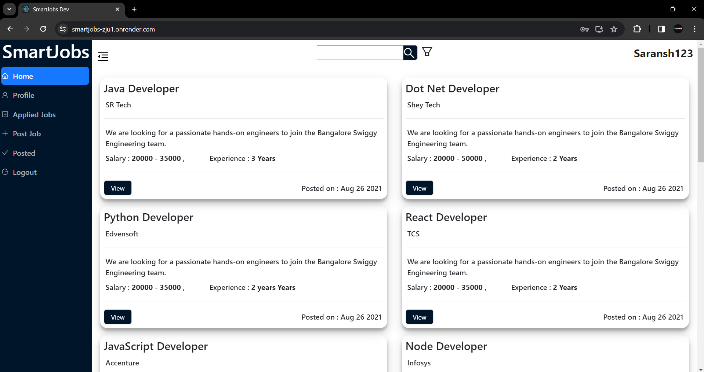

# 💼 SmartJobs

A full-stack job portal built with the **MERN stack** that connects job seekers with employers. [One line on your standout feature, e.g. "Employers post openings; candidates search and apply in a few clicks."]

[]()
[]()

**Live Demo:** [link if deployed] · **Screenshots:** see below

---

## ✨ Features

- [User registration and login]
- [Browse and search job listings]
- [Apply to jobs]
- [Employers post, edit and delete jobs]
- [Filter by role / location / experience]
- [Responsive UI]

> Replace the list above with what your app actually does.

---

## 🛠 Tech Stack

| Layer     | Technology                                   |
|-----------|----------------------------------------------|
| Frontend  | React, Redux, Redux Thunk, Axios             |
| Backend   | Node.js, Express                             |
| Database  | MongoDB with Mongoose                        |
| Other     | Moment.js, Nodemon, Concurrently             |

---

## 📁 Project Structure

```
smartjobs/
├── client/        # React frontend
├── models/        # Mongoose schemas
├── routes/        # Express API routes
├── db.js          # MongoDB connection
├── server.js      # Express server entry point
└── package.json
```

---

## 🚀 Getting Started

### Prerequisites

- Node.js `18.13.0` and npm `9.8.1`
- A MongoDB database (local or MongoDB Atlas)

### Installation

```bash
# 1. Clone the repo
git clone https://github.com/saranshmehta33/smartjobs.git
cd smartjobs

# 2. Install server dependencies
npm install

# 3. Install client dependencies
npm run client-install
```

### Environment Variables

Create a `.env` file in the root directory:

```env
MONGO_URI=your_mongodb_connection_string
PORT=5000
# Add any other variables your app uses, e.g. JWT_SECRET
```

### Run the App

```bash
# Run server and client together
npm run dev

# Server only
npm run server

# Client only
npm run client
```

- Frontend: http://localhost:3000
- Backend: http://localhost:5000

---

## 📜 Available Scripts

| Script                  | Description                              |
|-------------------------|------------------------------------------|
| `npm start`             | Start the production server              |
| `npm run server`        | Start the backend with Nodemon           |
| `npm run client`        | Start the React dev server               |
| `npm run dev`           | Run backend and frontend concurrently    |
| `npm run client-install`| Install client dependencies              |

---

## 🔌 API Endpoints

| Method | Endpoint              | Description            |
|--------|-----------------------|------------------------|
| POST   | `/api/[users/register]` | [Register a user]    |
| POST   | `/api/[users/login]`    | [Log in]             |
| GET    | `/api/[jobs]`           | [Get all jobs]       |
| POST   | `/api/[jobs]`           | [Create a job]       |

> Update this table to match your files in `routes/`.

---

## 📸 Screenshots

| Home | Job Listings |
|------|--------------|
|  |  |

---

## ☁️ Deployment

The `heroku-postbuild` script is configured, so the app can be deployed to Heroku. Set `MONGO_URI` as a config var in your dashboard.

---

## 🔮 Future Improvements

- [Email notifications]
- [Resume upload]
- [Admin dashboard]

---

## 🤝 Contributing

Pull requests are welcome. For major changes, please open an issue first.

## 📄 License

[ISC](LICENSE)

## 👤 Author

**Saransh Mehta**
GitHub: [@saranshmehta33](https://github.com/saranshmehta33)
