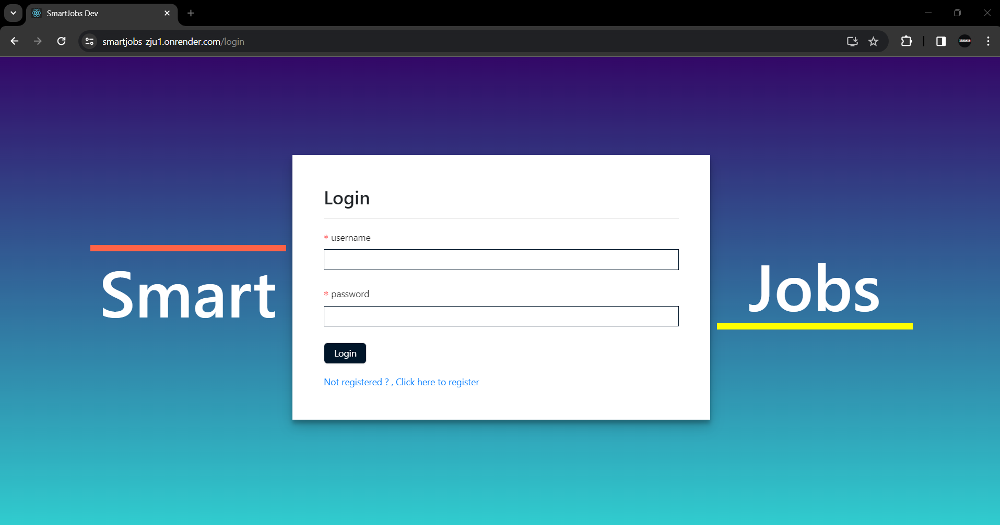
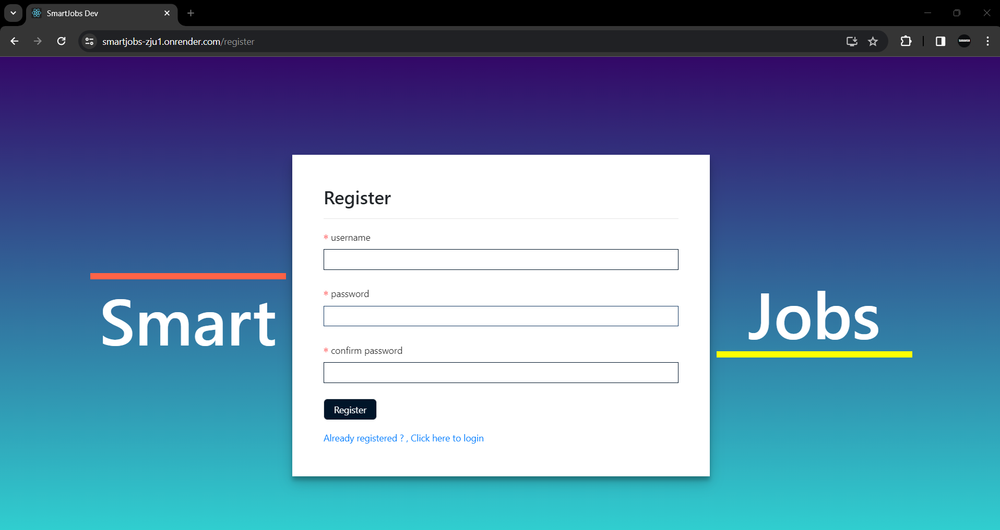
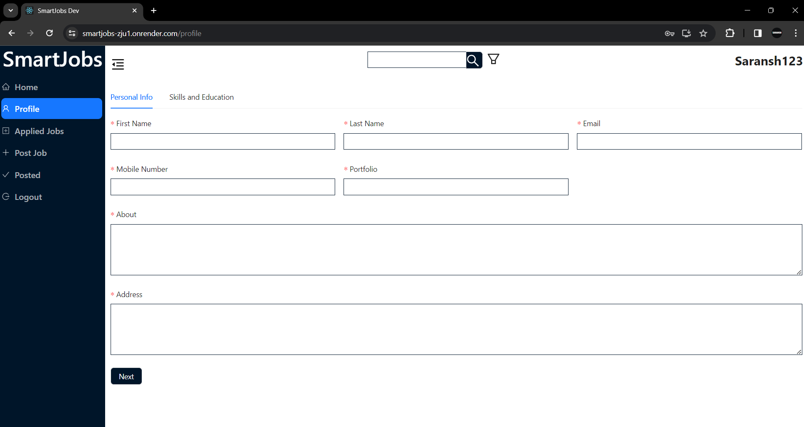
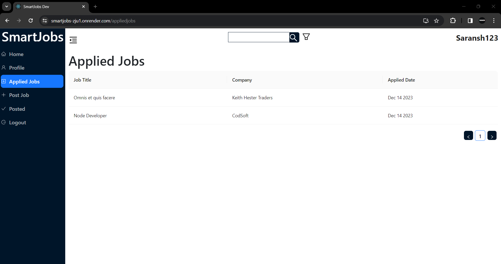
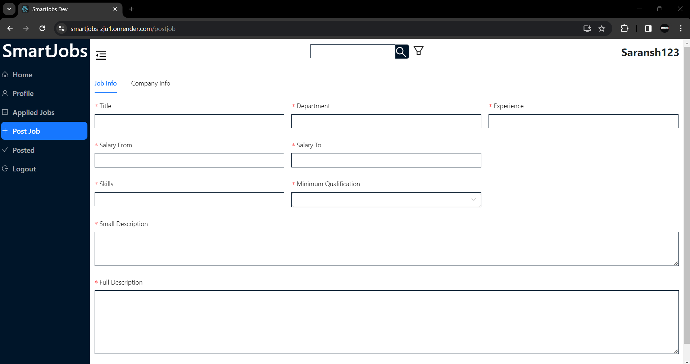
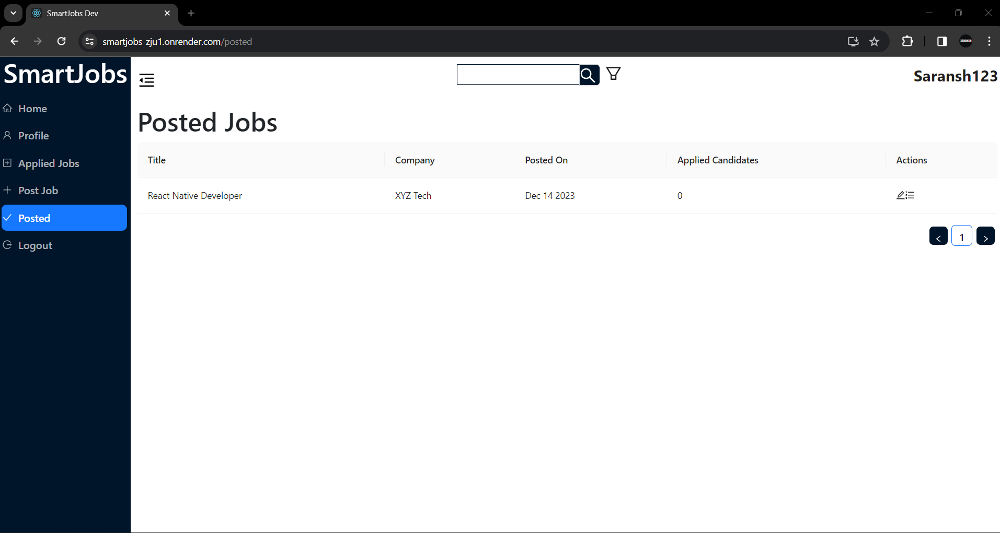

# 💼 Smart Jobs

A full-stack job portal built with the **MERN stack** where employers post job openings and job seekers search and apply for them. Smart Jobs aims to make the job search experience intuitive and efficient for both sides.

**Live Demo:** [add your deployed link here]

---

## 📌 Problem Statement

Build a job board website where employers can post job openings and job seekers can search and apply for jobs, using React.js, Node.js and a database (MongoDB or PostgreSQL). The project covers:

| # | Requirement | Description |
|---|-------------|-------------|
| 1 | Home Page | Display featured job listings |
| 2 | Job Listings Page | List of job openings with essential details |
| 3 | Job Detail Page | Detailed information about a specific job |
| 4 | Employer Dashboard | Account management and job posting |
| 5 | Candidate Dashboard | Profile management and job applications |
| 6 | Job Application Process | Application form with resume upload |
| 7 | Search Functionality | Search bar for finding specific jobs |
| 8 | User Authentication | Secure user login and data protection |
| 9 | Responsiveness | Works well on different devices |

---

## 🎯 Objectives

The goal of this internship project was to independently design, develop and deploy a fully functional job portal. It required hands-on expertise across the MERN stack: MongoDB, Express.js, React.js and Node.js.

---

## 🛠 Technologies Used

I was the sole contributor and implemented the entire stack myself.

| Technology | Usage |
|------------|-------|
| MongoDB | Database design and management |
| Express.js | Building the server-side application |
| React.js | Constructing the entire user interface |
| Ant Design (AntD) | UI component library for the interface |
| Node.js | Running the server-side JavaScript |
| Redux, Redux Thunk | State management |
| Axios | HTTP requests from the client |
| Mongoose | MongoDB object modelling |

---

## 📦 Modules

### 1. Authentication
- **Login:** secure sign-in for employers and candidates
- **Register:** account creation for new users

### 2. Home
Landing page showing featured job listings and the search bar.

### 3. Candidate Features
- **Profile:** manage personal details
- **Applied Jobs:** track every job you have applied to

### 4. Employer Features
- **Post Job:** create a new job opening
- **Posted Jobs:** view and manage the jobs you have posted

---

## 📸 Screenshots

| Login | Register |
|-------|----------|
|  |  |

| Home | Profile |
|------|---------|
|  |  |

| Applied Jobs | Post Job |
|--------------|----------|
|  |  |

| Posted Jobs |
|-------------|
|  |

---

## 📁 Project Structure

```
smartjobs/
├── client/        # React frontend (Ant Design)
├── models/        # Mongoose schemas
├── routes/        # Express API routes
├── db.js          # MongoDB connection
├── server.js      # Express server entry point
└── package.json
```

---

## 🚀 Getting Started

### Prerequisites

- Node.js `18.13.0` and npm `9.8.1`
- A MongoDB database (local or MongoDB Atlas)

### Installation

```bash
# Clone the repository
git clone https://github.com/saranshmehta33/smartjobs.git
cd smartjobs

# Install server dependencies
npm install

# Install client dependencies
npm run client-install
```

### Environment Variables

Create a `.env` file in the root directory:

```env
MONGO_URI=your_mongodb_connection_string
PORT=5000
```

### Run the App

```bash
# Run server and client together
npm run dev
```

- Frontend: http://localhost:3000
- Backend: http://localhost:5000

---

## 📜 Available Scripts

| Script | Description |
|--------|-------------|
| `npm start` | Start the production server |
| `npm run server` | Start the backend with Nodemon |
| `npm run client` | Start the React dev server |
| `npm run dev` | Run backend and frontend together |
| `npm run client-install` | Install client dependencies |

---

## ☁️ Deployment

The project includes a `heroku-postbuild` script that builds the React client, so it can be deployed to Heroku. Set `MONGO_URI` as a config var in the dashboard.

---

## 👤 Author

**Saransh Mehta**
GitHub: [@saranshmehta33](https://github.com/saranshmehta33)
